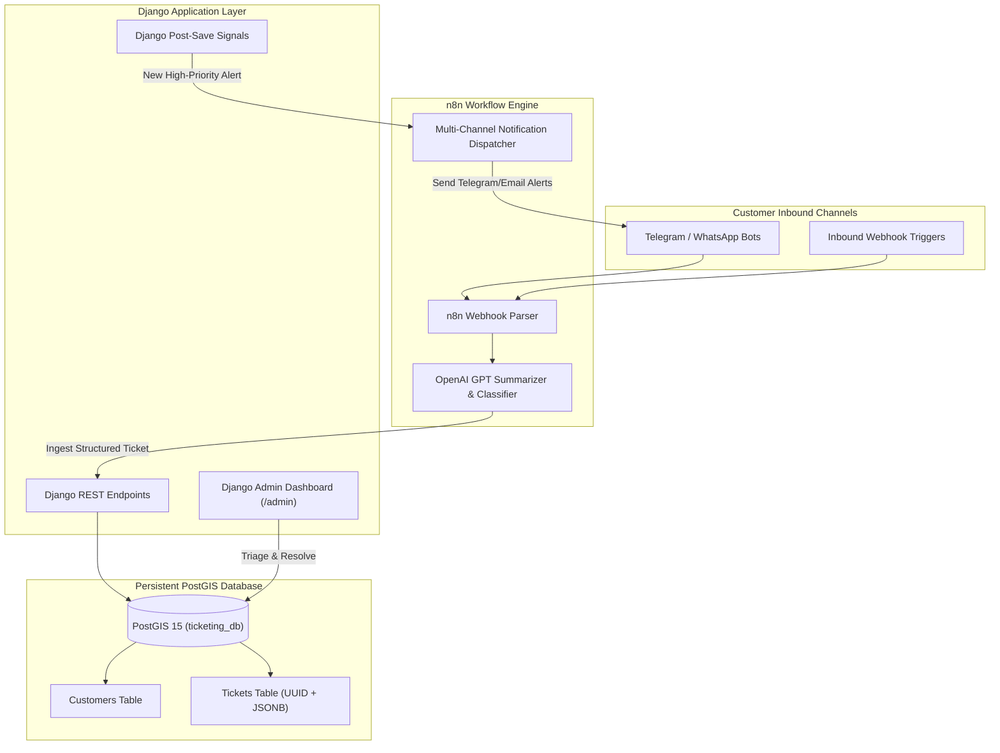

# Django Ticketing System & n8n Workflow Automation

<div align="center">

[](https://github.com/codewithmuh/n8n-django/releases)
[](https://opensource.org/licenses/MIT)
[](https://github.com/codewithmuh/n8n-django/stargazers)
[](https://github.com/codewithmuh/n8n-django/network/members)
[](https://www.djangoproject.com/)
[](https://postgis.net/)
[](https://www.docker.com/)
[](https://n8n.io/)
[](https://www.youtube.com/@codewithmuh)

**Production-ready Django CRM & Geospatial Ticketing Backend designed for autonomous n8n workflow integration, OpenAI ticket summarization, and automated multi-channel alert dispatching.**

[Features](#features) • [Architecture](#system-architecture) • [Quick Start](#quick-start) • [Database Schema](#database-schema) • [n8n Integration Guide](#n8n-workflow-integration)

</div>

---

## Overview

`n8n-django` delivers a robust customer relationship and ticketing backend built with Django and PostGIS (PostgreSQL with spatial extensions). Engineered specifically to act as the single source of truth for **n8n automation workflows**, this platform parses incoming unstructured communication, generates AI summaries with OpenAI, maps geolocation coordinates, and triggers multi-channel notification pipelines (Telegram, WhatsApp, Email).

---

## Features

- **Customer CRM:** Comprehensive directory mapping phone numbers, customer names, primary addresses, and unique site identifiers.
- **Geospatial & Spatial Tracking:** Embedded PostGIS support for geolocation coordinates (latitude, longitude) and location-source verification.
- **AI-Enhanced Ticketing:** Dedicated fields for unstructured original text and automated OpenAI analytical summaries.
- **JSONB Structured Payloads:** Flexible schema support for dynamic chatbot and form payloads.
- **Event-Driven Workflow Ready:** Automated status tracking (`High Priority`, `Medium Priority`, `Info`) and alert dispatch flags (`is_alert_sent`) for n8n polling or webhook triggers.
- **Turnkey Containerization:** Pre-configured Docker Compose with auto-migrating entrypoint scripts.

---

## System Architecture



---

## Quick Start

### Prerequisites

- [Docker](https://www.docker.com/) and [Docker Compose](https://docs.docker.com/compose/) installed.

### 1. Clone and Launch Containers

```bash
git clone https://github.com/codewithmuh/n8n-django.git
cd n8n-django

docker compose up --build -d
```

### 2. Verify Database Migrations & Superuser

The container's `entrypoint.sh` automatically applies database migrations and provisions default admin access.

- **Django Admin Interface:** `http://localhost:8000/admin/`
- **Default Username:** `admin`
- **Default Password:** `admin123`

### 3. Stop Containers

```bash
docker compose down
```

---

## Database Schema

### Customers Table (`customers`)
| Field | Type | Description |
|---|---|---|
| `phone_number` | `VARCHAR(20)` | **Primary Key** — International format phone number |
| `full_name` | `VARCHAR(255)` | Registered customer name |
| `address` | `TEXT` | Physical service address |
| `site_id` | `VARCHAR(100)` | Unique customer facility or branch code |

### Tickets Table (`tickets`)
| Field | Type | Description |
|---|---|---|
| `id` | `BIGINT` | Auto-incrementing internal primary key |
| `ticket_uuid` | `UUID` | Unique public identifier for tracking |
| `reporting_phone` | `FK -> Customers` | Link to customer who opened ticket |
| `ticket_timestamp` | `TIMESTAMP` | Auto-set creation timestamp with timezone |
| `ticket_subject` | `VARCHAR` | Choice: `self_location`, `registered_address` |
| `structured_response` | `JSONB` | Dynamic JSON payload extracted from chat/forms |
| `original_free_text` | `TEXT` | Unprocessed raw customer message |
| `openai_summary` | `TEXT` | AI-generated problem diagnosis and summary |
| `status` | `VARCHAR` | Priority rating: `High Priority`, `Medium Priority`, `Info` |
| `location_source` | `VARCHAR` | Source: `shared_location`, `from_customers_table` |
| `latitude` / `longitude`| `DECIMAL(10,7)` | High-precision GPS coordinates |
| `is_alert_sent` | `BOOLEAN` | Boolean flag indicating whether n8n dispatched alerts |

---

## n8n Workflow Integration

To integrate this backend with your n8n workflows:

1. **Inbound Ticket Webhook:** Configure an n8n workflow listening on customer chat channels (e.g., Telegram / WhatsApp / SMS).
2. **OpenAI Node:** Send raw text to an OpenAI Chat node to classify urgency and summarize the issue into structured JSON.
3. **HTTP Request Node (Create Ticket):** POST the structured data directly to the Django API.
4. **Outbound Dispatch Node:** Poll or receive Django webhooks for tickets where `status = 'High Priority'` and `is_alert_sent = False`, dispatch urgent notifications to on-call teams, and patch `is_alert_sent = True`.

---

## Project Structure

```
n8n-django/
├── Dockerfile              # Python 3.10 slim container definition
├── docker-compose.yml      # PostGIS 15 + Web services configuration
├── entrypoint.sh           # Migration and startup orchestration script
├── manage.py               # Django CLI utility
├── requirements.txt        # Python package dependencies
├── ticketing_system/       # Root Django configuration & routing
└── tickets/                # Core application (models, admin, migrations)
```

---

## License

This project is licensed under the [MIT License](LICENSE).
